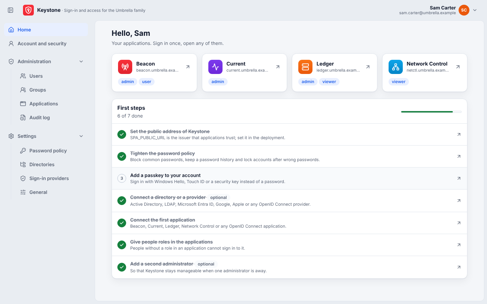

# SPA — Single Point of Authorization

[Русская версия](README.ru.md)

SPA is the one place where the people of the Umbrella family sign in and where their access is decided. It keeps
the accounts, groups, the password policy, passkeys, the connections to directories (LDAP / Active Directory,
Microsoft Entra ID) and to external sign-in providers (Google, Apple, any OpenID Connect provider), and it decides
which roles a person has in each application.

**Umbrella Monitoring, Umbrella Flow, Inventory DB, Network Control** and any other OpenID Connect application keep
no passwords, no password policy, no passkeys and no directory settings: they send people to SPA to sign in, read
their people and roles from SPA's federation API, publish their role catalogue to SPA and enforce the roles SPA
gives them.


- [docs/protocol.md](docs/protocol.md) — how applications connect to SPA (OpenID Connect, the connection key, the
  federation API, user synchronisation).
- [docs/api.md](docs/api.md) — the HTTP API: the OpenID Connect provider, the federation API and the `/api/v1`
  API of the web app.

## What it does

| | |
| --- | --- |
| Sign-in | local passwords under the password policy, LDAP / Active Directory, passkeys (Windows Hello, Touch ID, Face ID, Android, security keys), Microsoft Entra ID, Google, Apple, any OpenID Connect provider |
| People and groups | local accounts and accounts from directories and providers; SPA groups and directory groups (by DN or Entra object ID, created ahead of their members' first sign-in) |
| Applications | a three-step wizard connects an application and shows its connection key once; rules *person or group → role* decide who signs in to which application with which roles |
| Two-step verification | an authenticator app (TOTP, RFC 6238) as the second factor after a password (local or directory), one-time recovery codes; the password policy can require it of administrators or of everyone; a passkey counts as two factors by itself |
| Password policy | length, digits, special characters, mixed case, allowed alphabets, common-password blocking, lifetime with an expiry warning, history, lockout, a required second factor |
| Self-service | change the password (also an expired one, during the sign-in), set up two-step verification, add, rename and remove passkeys, see and end sessions |
| Audit | every sign-in and every change, searchable |
| Interface | English and Russian, light and dark theme, the Umbrella design |

## Screens

**Home** — the applications of the person, and the first steps for administrators.




**Applications** — connect an application in three steps: the application, who gets which role, the connection key.


**Users and groups**


**Settings** — password policy, directories, sign-in providers, general settings and the signing key.


**Account and security** — password, two-step verification, passkeys and sessions of the signed-in person.


**Sign-in** — dark theme, the change of a password at the first sign-in, and the Russian interface.


## Running SPA

### Docker Compose

```sh
cp .env.example .env
# set SPA_MASTER_KEY (openssl rand -base64 32), SPA_ADMIN_PASSWORD and SPA_PUBLIC_URL
docker compose up -d --build
```

SPA listens on `http://localhost:8080` (`SPA_PORT`). Sign in as `admin` with `SPA_ADMIN_PASSWORD`; SPA asks for
a new password at once. The **First steps** list on the home page leads through the rest: the password policy, a
passkey, a directory, the first application and its roles.

The image (`Dockerfile`) builds the web app with Node, the server with Go, and ships both on a distroless base
(non-root, about 27 MB). Put SPA behind a TLS reverse proxy in production and set `SPA_TRUSTED_PROXIES`.

### Configuration

| variable | |
| --- | --- |
| `SPA_DATABASE_URL` | PostgreSQL connection string (required) |
| `SPA_PUBLIC_URL` | the address of SPA and its OpenID Connect issuer, e.g. `https://spa.example.com` |
| `SPA_MASTER_KEY` / `SPA_MASTER_KEY_FILE` | base64 of 32 bytes that seals secrets in the database |
| `BAO_ADDR`, `BAO_TOKEN`, `BAO_MOUNT` | keep secrets in OpenBao (KV v2) instead |
| `SPA_ADMIN_USERNAME`, `SPA_ADMIN_PASSWORD` | the first administrator, created when SPA has no people |
| `SPA_SESSION_HOURS` | SPA session lifetime (default 12) |
| `SPA_TRUSTED_PROXIES` | networks whose `X-Forwarded-For` / `X-Forwarded-Host` are trusted |
| `SPA_LISTEN` | listen address (default `:8080`) |
| `SPA_WEB_DIR` | the built web app (default `./web`; `/app/web` in the image) |

### Two-step verification

People who sign in with a password — local accounts and LDAP / Active Directory accounts — turn on two-step
verification in **Account and security**: scan the QR code with an authenticator app (Google Authenticator,
Microsoft Authenticator, 1Password, Aegis, …; or type the key), confirm with a code, and save the ten one-time
recovery codes shown once. From then on SPA asks for the 6-digit code (30-second steps, one step of clock drift
either way, each code accepted once) after a right password; a recovery code works instead of a code once. Turning
it off, changing the app and new recovery codes need a current code.

**Password policy → Second factor** makes it *required for administrators* or *required for everyone*: a person who
must have it and has none sets it up right after the password, before the sign-in finishes (also after a change of an
expired password). A passkey sign-in is two-factor by itself and never asks for a code; sign-in through Microsoft
Entra ID, Google, Apple or OpenID Connect leaves the second factor to that provider. An administrator turns off the
second factor of a person who lost their phone (**Users → Actions**).

The secret is kept like SPA's other secrets — in OpenBao or sealed with the master key in the database
(`totp/<user id>`) — and the recovery codes only as keyed hashes (HMAC-SHA256). Wrong codes count like wrong
passwords (the lockout of the policy, and 20 attempts per address in 5 minutes). Enrolment, turning off, wrong codes
and used recovery codes go to the audit log. Applications see a password sign-in with a code as `amr: ["pwd", "otp",
"mfa"]`.

### Connecting an application

**Applications → Connect an application**: choose the type, enter the address, give groups or people roles, and
copy the **connection key** (`spa1.…`) into the application's `SPA_CONNECTION_KEY`. The application then offers
"Sign in with SPA" and synchronises its people every 5 minutes. **Issue a new key** replaces the key; the old one
stops working at once. Details: [docs/protocol.md](docs/protocol.md).

## Development

```
backend/   Go server: cmd/spa, internal/app (HTTP), store (PostgreSQL), policy, totp, passkey, directory, entra, oidcx, secrets
web/       React + TypeScript + Vite web app (src/pages, src/components, src/i18n)
scripts/   seed-demo.mjs (demo data through the API), screenshots.mjs (README screenshots with Playwright)
docs/      protocol.md, api.md, screens/
```

| | |
| --- | --- |
| `make build` | the web app (`web/dist`) and the server (`backend/spa`) |
| `make test` | `go vet` and `go test ./...` (set `SPA_TEST_POSTGRES` for the database tests) and the web tests (vitest) |
| `make run` | build and run SPA with the built web app (needs `SPA_DATABASE_URL` and `SPA_MASTER_KEY`) |
| `make dev` | the web app with hot reload on `:5173`, the API proxied to SPA on `:8080` |
| `make docker`, `make up`, `make down` | the image; SPA and PostgreSQL with Docker Compose |
| `make seed` | demo data in a running SPA: people, groups, the four Umbrella applications, a password policy |
| `make screenshots` | the screenshots in `docs/screens` (on an empty database; Playwright with Chromium) |

The web app follows the Umbrella design (the tokens and controls of the Umbrella monitoring app, as in
Inventory DB): the shell with the sidebar and the page block, cards, tables, pills, segmented controls and dialogs,
light and dark themes kept in `localStorage` (`spa.theme`), and English and Russian. The English strings are the
keys of `web/src/i18n/en.ts` and `ru.ts`; `web/src/i18n/completeness.test.ts` fails when a string used by the app —
or an error message of the API — lacks a text in either language.

The web app calls only the `/api/v1` API with the session cookie; every request that changes something carries
`X-Requested-With: spa`. Pages an auditor may read are shown read-only to auditors; the API enforces the roles.
