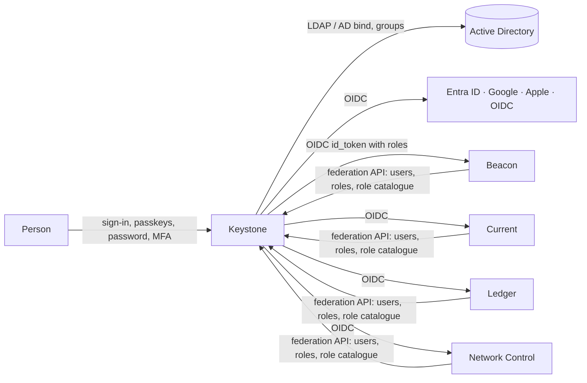

# The Keystone protocol — how applications use Keystone

> Keystone was called **SPA (Single Point of Authorization)** before the products of the Umbrella family got their
> own names. The protocol is unchanged: its wire identifiers keep the historical `spa` spelling so that connected
> applications and existing deployments keep working — the connection key prefix `spa1.`, the environment variables
> `SPA_CONNECTION_KEY`, `SPA_CONNECTION_KEY_FILE` and `SPA_PUBLIC_URL`, the federation API under `/api/spa/v1/`, the
> application endpoints `/api/auth/spa/start` and `/api/auth/spa/callback`, the OpenBao key `spa/connection_key`, the
> `spa_admin` claim and `source = spa` in the applications' user records.

Keystone is the only place where people of the Umbrella family authenticate and where their access is decided. It
keeps the accounts, groups, the password policy, passkeys, the connections to directories (LDAP / Active
Directory, Microsoft Entra ID) and to external sign-in providers (Google, Apple, any OpenID Connect provider), and
it decides which roles a person has in each application.

Applications — **Beacon, Current, Ledger, Network Control** and any other OpenID Connect
application — keep **no passwords, no password policy, no passkeys and no directory settings**. They:

1. send people to Keystone to sign in (OpenID Connect, authorization code flow with PKCE);
2. read the people who may use them and their roles from Keystone (the federation API) to create, update and disable
   their local user records (needed for ownership, on-call teams, audit, etc.);
3. publish their own role catalogue to Keystone, so that Keystone administrators assign those roles;
4. enforce the permissions of the roles Keystone gives them.



Machine access (API tokens of an application for scripts and integrations) stays in the application: it is not a
person signing in. Every token still belongs to a person known from Keystone and stops working when Keystone disables that
person.

## 1. Registering an application

In Keystone: **Applications → Connect an application** (three steps):

1. **Application** — the type (`beacon`, `current`, `ledger`, `network-control`, `oidc`; the IDs from before the
   rename — `umbrella-monitoring`, `umbrella-flow`, `inventory-db` — are still accepted and stored as the new ones),
   its name and address `https://…`. The redirect address is `<address>/api/auth/spa/callback`; the address after
   sign-out is `<address>/`. For `oidc` both are entered by hand.
2. **Access** — the roles of the application (the catalogue; the app replaces it with its own once it connects,
   §3) and who gets which: rules *user or group → role*. People with no role in the application cannot sign in to it.
3. **Connection key** — Keystone creates the OpenID Connect client (client ID and secret) and the federation token of
   the application and shows the **connection key** once:

```
spa1.<base64url(JSON)>
{"issuer":"https://keystone.example.com","client_id":"app_…","client_secret":"…","token":"…"}
```

Keystone keeps only keyed hashes (HMAC-SHA256) of the secret and the token. **Issue a new key** replaces both; the old
ones stop working at once.

### In the application

The key is given to the application in its deployment configuration — **the environment variable
`SPA_CONNECTION_KEY`** (or the file named by `SPA_CONNECTION_KEY_FILE`, or the OpenBao secret the application
already uses for its own secrets, key `spa/connection_key`). There is no sign-in without it: an application that is
not connected shows "This application is not connected to Keystone" with the instructions above instead of a sign-in
form. Optional: `SPA_PUBLIC_URL` — the address of the application when it differs from the request address (used
for the redirect address).

Because no person can sign in to an application before it is connected, an application has no "first
administrator" set-up of its own any more: the first administrator is whoever Keystone gives the application's
administrator role.

## 2. Sign-in (OpenID Connect)

Discovery: `GET <issuer>/.well-known/openid-configuration`. Endpoints:

| | |
| --- | --- |
| authorization | `GET <issuer>/oauth2/authorize` |
| token | `POST <issuer>/oauth2/token` (`client_secret_post` or `client_secret_basic`) |
| keys | `GET <issuer>/oauth2/jwks` (RS256) |
| user info | `GET|POST <issuer>/oauth2/userinfo` (Bearer access token) |
| sign-out | `GET <issuer>/oauth2/logout?post_logout_redirect_uri=…&client_id=…` |

Flow:

1. The application's sign-in page offers one button, **Sign in with Keystone**, and goes there by itself when the person
   arrives without a session (unless they were just signed out). `GET /api/auth/spa/start?return=<path>` creates
   `state`, `nonce` and a PKCE verifier, keeps the verifier in a short-lived HttpOnly cookie (`SameSite=Lax`) bound to
   the signed `state`, and redirects to `/oauth2/authorize` with `response_type=code`, `scope=openid profile email
   groups roles`, `code_challenge_method=S256` (**required**), `state`, `nonce`. Optional parameters:
   `login_hint=<username>`, `idp_hint=<method>` (`password`, `passkey`, `ldap`, `entra`, `google`, `apple`, `oidc`)
   to open a sign-in method directly, `prompt=login` to ask again even with a Keystone session.
2. Keystone signs the person in (its own session, any method allowed by Keystone) and checks access: a person without a role
   in the application gets `error=access_denied`.
3. `GET <app>/api/auth/spa/callback?code=…&state=…` — the application checks `state` against the cookie, redeems the
   code with the verifier, verifies the ID token (signature from the JWKS, `iss`, `aud`, `exp`, `nonce`), finds or
   creates the local user bound to `sub` (§4), and starts its own session. Errors come back as
   `?error=…&error_description=…`; the application shows them on its sign-in page (`/login?sso_error=…`).

ID token and user info claims:

| claim | |
| --- | --- |
| `sub` | the Keystone user ID — the only stable key; never bind by name or e-mail |
| `preferred_username`, `name`, `email`, `email_verified` | |
| `roles` | the person's roles **in this application** (role IDs of its catalogue), at least one |
| `groups` | Keystone groups of the person (names) |
| `amr` | how the person signed in: `pwd`, `hwk` + `user` (passkey with user verification), `fed` (directory or provider), `otp` (the code of an authenticator app after the password), plus `mfa` when two factors were used |
| `auth_time`, `sid` | |
| `spa_admin` | `true` for Keystone administrators (information only) |

Sessions: the application's session lasts as configured in the application (default 12 h) but never longer than the
Keystone account stays enabled with a role in the application (§4 revokes it). **Sign out** in the application ends the
local session and redirects to Keystone's sign-out (which ends the Keystone session and returns to the application's address).

## 3. Federation API

Requests carry `Authorization: Bearer <token>` (the token of the connection key). JSON. Answers of GET carry an
`ETag`; send `If-None-Match` to get `304 Not Modified`. `401` means the key was replaced or the application removed.

### `GET <issuer>/api/spa/v1/config`

```json
{
  "application": {"id": "app_…", "name": "Network Control", "type": "network-control"},
  "roles": [{"id": "admin", "name": "Administrator", "description": "…"}],
  "methods": [{"id": "passkey", "title": "Passkey"}, {"id": "ldap", "title": "Active Directory"}],
  "sign_out_url": "https://keystone.example.com/oauth2/logout",
  "account_url": "https://keystone.example.com/profile",
  "user_import": false
}
```

`user_import` is `true` while a Keystone administrator has opened the import window of this application (see
`POST /api/spa/v1/users/import` below); applications use it to offer "Move local users to Keystone".

`account_url` is where a person changes their password and manages passkeys; applications link to it from their
user menu ("Account and security").

### `GET <issuer>/api/spa/v1/users`

Everyone who has at least one role in the application, enabled or not:

```json
{"users": [{
  "id": "usr_…", "username": "jdoe", "email": "jdoe@example.com", "name": "John Doe",
  "disabled": false, "roles": ["operator"], "groups": ["noc"], "source": "ldap",
  "updated_at": "2026-10-15T12:00:00Z"
}]}
```

### `PUT <issuer>/api/spa/v1/roles`

The application publishes its role catalogue — at start and whenever its roles change (Beacon and
Current have custom roles):

```json
{"roles": [{"id": "admin", "name": "Administrator", "description": "Everything"},
           {"id": "viewer", "name": "Viewer", "description": "Read only"}],
 "default": "viewer"}
```

`id` is what the application understands (`[a-z0-9_.:-]{1,64}`); names and descriptions are what Keystone administrators
see. Assignments to a role that disappears from the catalogue stay in Keystone but are not given out (Keystone shows them as
"unknown role"). `default` is suggested to Keystone administrators for new rules.

### `POST <issuer>/api/spa/v1/users/import`

An application that had its own local users before it was connected moves them to Keystone once. Keystone accepts the
request only while the **import window** of the application is open: a Keystone administrator opens it with
**Allow moving users** on the application's card; it closes after the first request that imports at least one person,
or 24 hours after it was opened, whichever comes first. `GET /api/spa/v1/config` tells whether it is open
(`"user_import": true`).

Request (at most 1000 people per request):

```json
{"users": [
  {"username": "jdoe", "name": "John Doe", "email": "jdoe@example.com", "role": "operator",
   "password_hash": "$argon2id$v=19$m=65536,t=3,p=4$c2FsdHNhbHRzYWx0$3q2+7w…"},
  {"username": "ann", "name": "Ann", "email": "", "role": "viewer", "password_hash": null}
]}
```

- `username` — required; up to 128 characters, no spaces, tabs, `/` or `\`. Compared with existing Keystone
  accounts without regard to case.
- `name`, `email` — optional; an e-mail that is not valid (no `@`, or longer than 256 characters) is left empty.
- `role` — required; the ID of one of the roles the application published (`PUT /api/spa/v1/roles`; until it
  publishes, its fixed catalogue). Keystone gives the person this role in the application right away (a rule
  "person → role").
- `password_hash` — the person's password hash as the application kept it, in one of two formats:
  - `pbkdf2-sha256$<iterations>$<salt>$<key>` — PBKDF2-HMAC-SHA256, salt and key in base64 (standard alphabet,
    padding optional), 1000 – 10 000 000 iterations, salt at least 8 bytes, key 16–64 bytes (Keystone's own format);
  - `$argon2id$v=19$m=<KiB>,t=<passes>,p=<lanes>$<salt>$<hash>` — Argon2id in the PHC string format (what
    argon2-cffi and passlib write), salt and hash in base64 (standard alphabet, padding optional); `m` from 8·`p` up
    to 262144 (256 MiB), `t` 1–10, `p` 1–16, salt at least 8 bytes, hash 16–64 bytes.

  Keystone checks the password against this hash at the person's first sign-in and then replaces it with a PBKDF2
  hash of its own. The hash is kept in Keystone's secret store (OpenBao), never in its database.
  `null` (or `""`): the person is created without a password and must get one — a Keystone administrator sets a
  temporary password (**Users → the person → Set password**), which the person changes at the first sign-in.

Imported people are local Keystone accounts (`source = local`) with the Keystone role `user`. Two-step verification
(TOTP) is not moved: people turn it on again in Keystone. Existing Keystone accounts are **never changed**: a person
whose user name or e-mail is taken is reported as a conflict and skipped.

Answer `200`:

```json
{"imported":  [{"username": "jdoe", "id": "usr_…"}],
 "conflicts": [{"username": "admin", "reason": "username_taken"}],
 "rejected":  [{"username": "bad name", "reason": "invalid_username"}]}
```

Every entry of the request is in exactly one of the three lists (each list keeps the order of the request; the lists
are always present, empty as `[]`). Reasons:

| list | reason | meaning |
| --- | --- | --- |
| `conflicts` | `username_taken` | a Keystone account, or an earlier entry of this request, has this user name |
| `conflicts` | `email_taken` | a Keystone account, or an earlier entry of this request, has this e-mail |
| `rejected` | `invalid_username` | the user name is empty, too long, or has spaces or slashes |
| `rejected` | `invalid_role` | the role is not one of the application's roles |
| `rejected` | `invalid_hash` | the hash is in neither format, or its parameters are out of range |

The checks run in the order `invalid_username`, `invalid_role`, `invalid_hash`, `username_taken`, `email_taken`; the
first that fails decides the reason.

Errors: `401` — the token is missing or not valid; `403 {"error": "import_not_allowed"}` — the import window of the
application is not open; `400 {"error": "too_many_users"}` — more than 1000 entries; `400 {"error": "bad_request"}` —
the body is not the JSON above. Error answers also carry `code` (the same value) and an English `message`.

Everything goes to Keystone's audit log: the import (`application.users_imported` with the counts), every created
person (`user.created` with `"source": "import"`), and the opening and closing of the window.

### Fixed catalogues

| application (type) | roles |
| --- | --- |
| Beacon (`beacon`) | `admin`, `user` and its custom roles, published by ID |
| Ledger (`ledger`) | `admin`, `editor`, `viewer` (DCIM/IPAM role; base membership is data and stays in Ledger) |
| Current (`current`) | its roles table (system `admin` plus custom roles), published by ID |
| Network Control (`network-control`) | `admin`, `operator`, `viewer` |
| any OpenID Connect application (`oidc`) | `user`, or the roles entered when connecting it |

## 4. Users in the application

Every 5 minutes (leader/one replica only), and on **Synchronize now** in the application's user page:

- `GET /api/spa/v1/users` (with the ETag); for each user: create or update the local record bound to `id`
  (`source = spa`, `external_id = id`), set username, name, e-mail and role(s) from `roles`;
- a user who is `disabled`, or is missing from the list, is disabled locally and **all their sessions and API tokens
  stop working**;
- the first sign-in of a person not yet synchronised creates the record from the ID token claims.

Local user management in the application is reduced to what is not identity: display preferences, team/on-call
membership, ownership. Creating users, passwords, roles, enabling/disabling — "Managed in Keystone" with a link.

Applications show the Keystone connection on their settings page: issuer, application name, last synchronisation,
counts, errors, **Synchronize now**.

## 5. Security notes

- PKCE S256 and `nonce` are required; `state` is signed and single use; the verifier cookie is HttpOnly, `Secure` on
  https, `SameSite=Lax`, path `/api/auth/spa/`, 10 minutes.
- Authorization codes live 60 s and are single use; ID tokens 5 min; access tokens 10 min (user info only).
- Keystone's signing key (RSA 2048) is kept in its secret store; the JWKS lists the current and the previous key.
- Redirect addresses must match the registered ones exactly.
- Applications must not accept an ID token from another issuer or for another audience, and must not trust
  `email` for binding.
